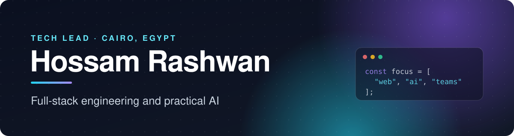

  

### Hi, I'm Hossam 👋

I am a tech lead at [Sieraj](https://github.com/Sieraj), a digital agency in Cairo. I have 12 years of experience building web applications across the full stack, and I now focus on practical AI: RAG, agents, and the interfaces around them.

### What I am working on

- 🚀 Leading the engineering of [Ideoz](https://ideoz.ai), an agentic AI platform that turns a founder's idea into a working prototype
- 🧩 Building small, focused TypeScript tools for AI chat interfaces in the open (first release coming soon)

### Tech stack

  
  
  
  
  
  
  

### Connect

  

